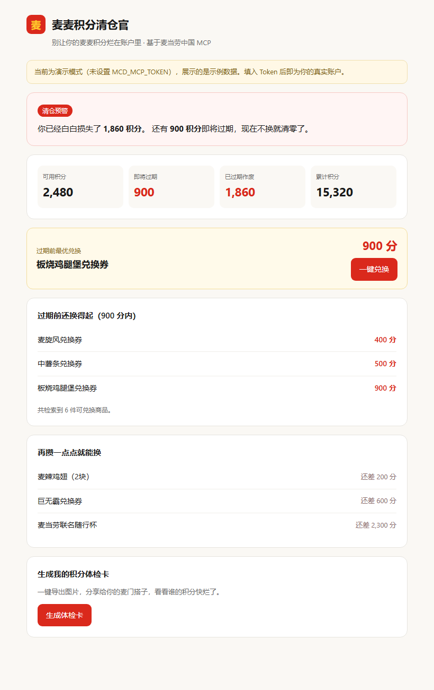
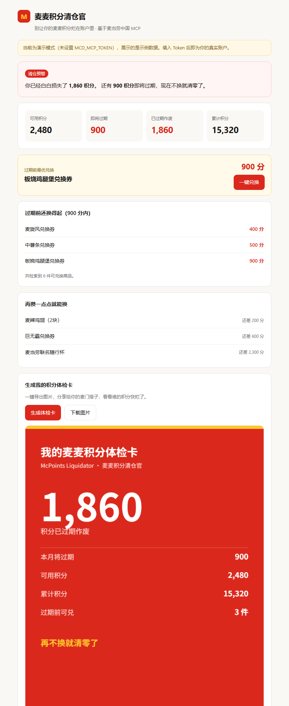

# 麦麦积分清仓官 · McPoints Liquidator

> 你的麦麦积分正在悄悄过期。官方 App 不会提醒你，这个会。
>
> **已在真实麦当劳账户完成联调验证** —— 实测读到「已过期作废 2938 分、本月将过期 39 分」，商城商品与兑换链路全部走通。

基于**麦当劳中国官方 MCP Server** 的积分生命周期管理工具。读取你的积分账户，找出即将过期的那部分，算出「过期前最划算能换什么」，一键兑换，并生成一张可分享的**积分体检卡**。

零第三方依赖，Python 标准库 + 一个 HTML 文件，两个文件跑起来。



点击「生成体检卡」会导出一张可分享的图片（左下角），把一次个人查询变成社交货币：



## 它解决什么问题

麦麦积分是**会过期**的沉默资产。官方渠道不会主动告诉你「你有 900 分下个月清零」，更不会告诉你这 900 分现在最该换成什么。大多数人是在积分已经归零之后才想起来。

本项目把这条隐性信息显性化，并把「查积分 → 逛商城 → 心算比价 → 下单」四步压缩成一次点击。

## 快速开始

```bash
# 1. 申请 Token：https://open.mcd.cn/mcp （手机号登录 → 控制台 → 激活 → 复制）
# 2. 启动
export MCD_MCP_TOKEN="你的Token"          # Windows: set MCD_MCP_TOKEN=你的Token
python mcd_liquidator.py
# 3. 浏览器打开 http://127.0.0.1:8848
```

**没有 Token 也能直接跑。** 未检测到 `MCD_MCP_TOKEN` 时自动进入演示模式，用示例数据展示完整流程，看完效果再决定要不要接真实账户。

命令行模式（不启 Web，直接打印报告）：

```bash
python mcd_liquidator.py --scan
```

```
----------------------------------------------------
  麦麦积分体检报告
----------------------------------------------------
  可用积分      : 2480
  即将过期积分  : 900 <-- 有清仓风险!
  已过期作废    : 1860 <-- 这些已经白白损失了
  累计积分      : 15320
----------------------------------------------------
  过期前可兑 (900 分内):
    - 麦旋风兑换券        400 分
    - 中薯条兑换券        500 分
    - 板烧鸡腿堡兑换券    900 分
  最优解: 板烧鸡腿堡兑换券 (900 分)
----------------------------------------------------
```

## 核心决策逻辑

| 输出项 | 规则 | 为什么这样设计 |
|---|---|---|
| 已过期账单 | `expiredPoint` | 沉没成本。实测这个数字往往远大于「即将过期」，也更有冲击力 |
| 清仓预警 | `currentMouthExpirePoint + nextMouthExpirePoint > 0` | 全 tool 列表中唯一带时间压力的数据，是项目的触发点 |
| 过期前还换得起 | `points <= 即将过期积分` | 只给「现在就能换」的，避免给了换不起的建议 |
| 最优解 | 上述集合中**积分价最高**的一件 | 临期积分必须最大化消耗，最小化浪费 |
| 再攒一点点 | 超出池子、按差额升序取前 5 | 把「差一点」变成下次消费的动力 |

## 用到的 MCP Tool

| Tool | 作用 |
|---|---|
| `query-my-account` | 读取可用/累计/冻结/**即将过期**积分 |
| `mall-points-products` | 拉取麦麦商城可兑换商品池 |
| `mall-product-detail` | 兑换前确认商品详情与有效期 |
| `mall-create-order` | 积分兑换下单，完成闭环 |
| `query-my-coupons` | 券与积分叠加使用的辅助判断 |

完整调用链路与字段容错设计见 [MCP_INTEGRATION.md](MCP_INTEGRATION.md)。

## 项目结构

```
mcd-points-liquidator/
├── mcd_liquidator.py        # 全部逻辑：MCP 客户端 + 本地服务 + 决策（单文件，零依赖）
├── web/index.html           # 前端单页，含体检卡导出
├── skill/SKILL.md           # WorkBuddy Skill 定义
├── CONTEST_DECLARATION.md   # 参赛声明（官方原文，不可改动）
├── MCP_INTEGRATION.md       # MCP 接入说明
└── workbuddy.md             # WorkBuddy 开发对话记录
```

## 设计取舍

- **零依赖**：只用标准库，`python mcd_liquidator.py` 即跑，不需要 `pip install`。
- **字段模糊匹配**：麦当劳 MCP 各版本返回字段名有差异（`expiringPoints` / `soonExpire` / `即将过期`），项目用 `dig()` 递归模糊匹配而非写死字段名，MCP 升级后无需改代码。
- **双协议解析**：MCP 响应可能是 JSON 也可能是 SSE（`text/event-stream`），两种都做了解析。
- **演示模式兜底**：Token 无效或网络异常时回落演示数据并提示，不白屏、不崩溃。
- **积分兑换需显式确认**：未点击「一键兑换」绝不调用 `mall-create-order`，积分兑换不可逆。
- **已过期与即将过期分开读**：`expiredPoint`（已作废）与 `currentMouthExpirePoint`（将过期）是两个字段，混读会把沉没成本当成待清仓库存。
- **按类目拉取商城商品**：无参数调用会混入大量 `point=0` 的生日派对商品，项目按 `1>4` / `2` / `2>8` / `2>9` 四个类目分别拉取后合并去重。

## 免责声明

本项目是麦当劳程序员创意开发大赛参赛作品，由参赛者独立开发，**非麦当劳官方产品**。输出仅供参考，商品信息、积分规则与供应状态以麦当劳官方渠道实时结果为准。Token 仅从环境变量读取，不包含在任何文件中。

## License

MIT
